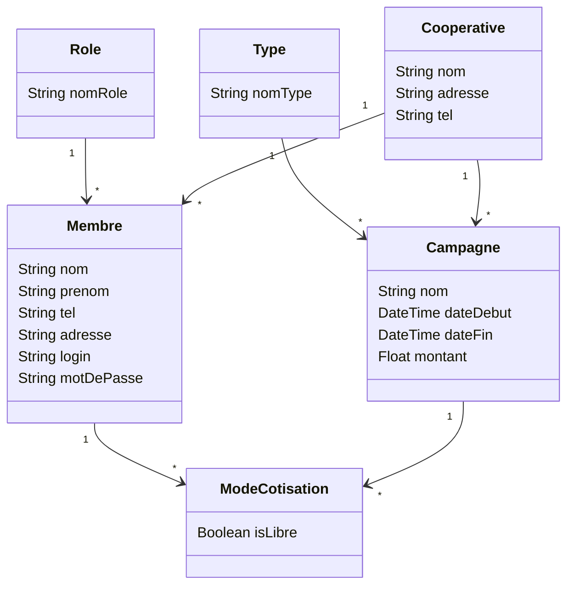

# Modélisation du projet gestion-prets

Source : modèle dessiné au tableau en cours (22/10/2026).

## Diagramme de classes (modèle de base)

## Lecture du modèle

- Un **rôle** peut être attribué à plusieurs membres.
- Un **type** peut être associé à plusieurs campagnes.
- **ModeCotisation** relie les membres aux campagnes (un membre participe à plusieurs campagnes, une campagne a plusieurs membres) et indique si la cotisation est libre.
- Une **coopérative** regroupe des membres et des campagnes.

## Prochaines évolutions prévues

- Remplacer le `Type` des campagnes par de l'héritage (une classe par type).
- Ajouter les prêts : un membre peut faire un prêt pour une durée donnée.