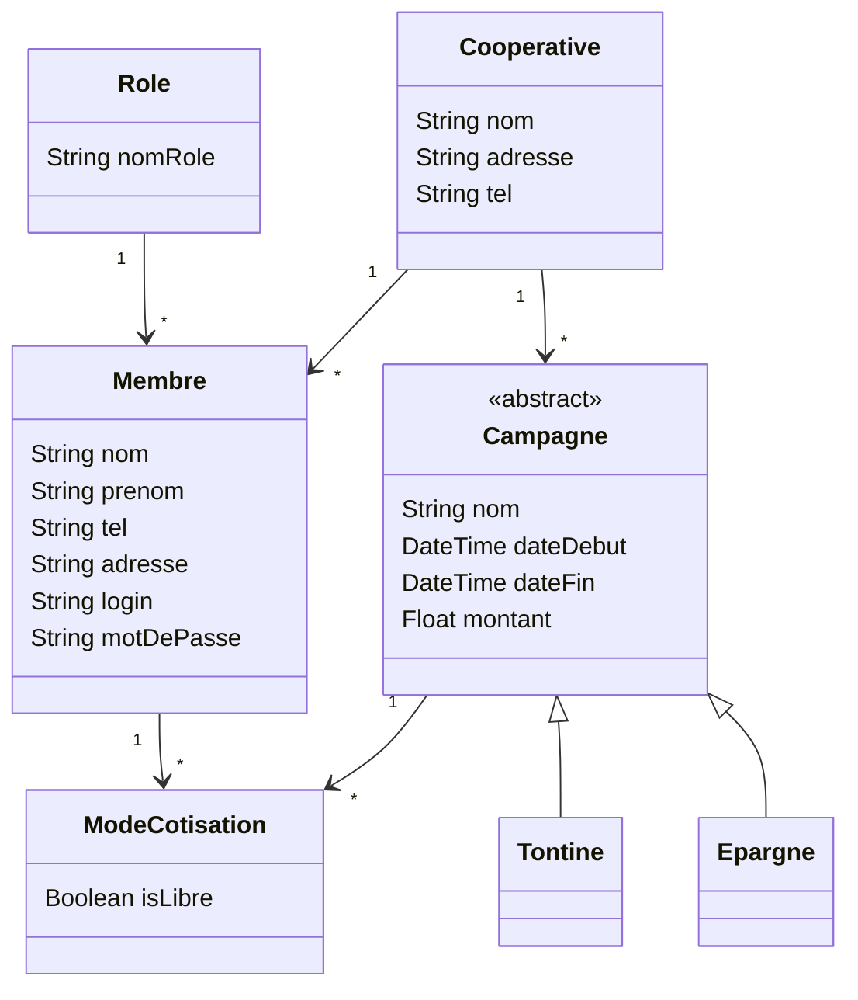

# Modélisation du projet gestion-prets

Source : modèle dessiné au tableau en cours (22/10/2026).

## Diagramme de classes

## Lecture du modèle

- Un **rôle** peut être attribué à plusieurs membres.
- **Campagne** est une classe abstraite : on crée toujours une `Tontine` ou une `Epargne`, qui héritent de ses champs. Elle remplace la table `Type` du modèle de départ, ce qui permet d'ajouter un nouveau type de campagne en créant simplement une classe.
- **ModeCotisation** relie les membres aux campagnes (un membre participe à plusieurs campagnes, une campagne a plusieurs membres) et indique si la cotisation est libre.
- Une **coopérative** regroupe des membres et des campagnes.

## À confirmer

- Le nom de la classe `Cooperative` : nom provisoire.
- Les noms `Tontine` et `Epargne` : noms provisoires.

## Prochaines évolutions prévues

- Ajouter les prêts : un membre peut faire un prêt pour une durée donnée.