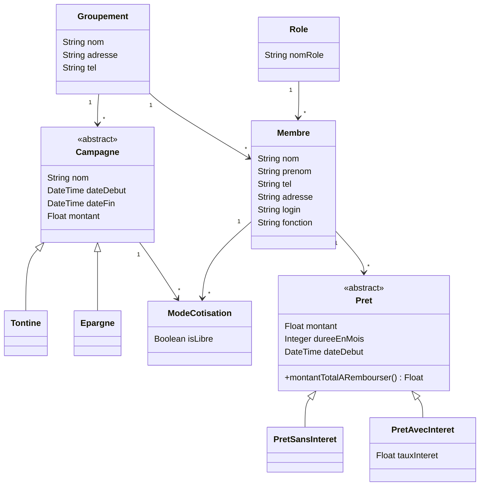

# Modélisation du projet gestion-prets

Ce document décrit le modèle de classes de l'application : groupements, membres, campagnes (tontines et épargnes) et prêts.

## Diagramme de classes

## Lecture du modèle

- Un **groupement** regroupe des membres et des campagnes.
- Un **rôle** peut être attribué à plusieurs membres.
- **Campagne** est une classe abstraite : une campagne est toujours une `Tontine` ou une `Epargne`, qui héritent de ses attributs.
- **ModeCotisation** est une classe-association entre `Membre` et `Campagne` : un membre participe à plusieurs campagnes, une campagne compte plusieurs membres, et l'attribut `isLibre` indique si la cotisation est libre. Le diagramme Mermaid la représente par deux relations, car Mermaid ne gère pas les classes-association.
- Un **membre** peut faire plusieurs **prêts**, chacun pour une durée donnée.
- **Pret** est une classe abstraite : un prêt est toujours un `PretSansInteret` ou un `PretAvecInteret`, qui ajoute un `tauxInteret`.

## Choix de conception

- **Héritage plutôt que table de types** : pour ajouter un nouveau type de campagne ou de prêt, il suffit de créer une classe, sans modifier les autres. Le modèle reste évolutif.
- **Polymorphisme pour les prêts** : la méthode abstraite `montantTotalARembourser()` est déclarée dans `Pret` et écrite différemment par chaque classe enfant. Pour un prêt sans intérêt, c'est le montant emprunté. Pour un prêt avec intérêt, c'est le montant plus les intérêts.
- **Calcul des intérêts** : le taux est annuel, exprimé en pourcentage, et les intérêts sont simples : montant × taux ÷ 100 × durée en mois ÷ 12.

## Évolutions prévues

- Création des entités Doctrine et des fixtures à partir de ce modèle.
- Version du diagramme au format UML (StarUML).