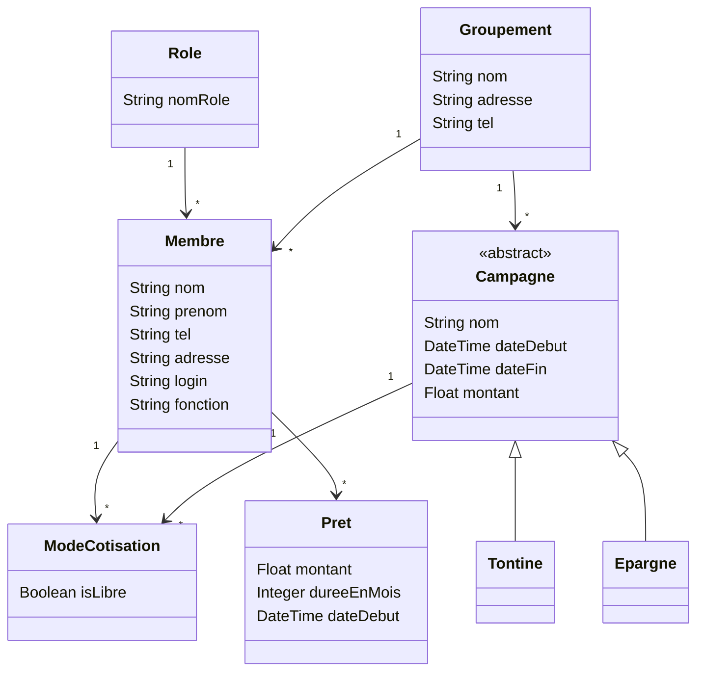

# Modélisation du projet gestion-prets

Source : modèle dessiné au tableau en cours (22/10/2026).

## Diagramme de classes

## Lecture du modèle

- Un **rôle** peut être attribué à plusieurs membres.
- **Campagne** est une classe abstraite : on crée toujours une `Tontine` ou une `Epargne`, qui héritent de ses champs. Elle remplace la table `Type` du modèle de départ, ce qui permet d'ajouter un nouveau type de campagne en créant simplement une classe.
- **ModeCotisation** relie les membres aux campagnes (un membre participe à plusieurs campagnes, une campagne a plusieurs membres) et indique si la cotisation est libre.
- Une **coopérative** regroupe des membres et des campagnes.

## Points confirmés

- Le nom `Groupement` (classe reliée à `Membre` et `Campagne`) : confirmé par un camarade.
- Les noms `Tontine` et `Epargne` (classes enfants de `Campagne`) : confirmés.
- Le dernier attribut de `Membre` est `fonction` : confirmé.
- Les prêts : le professeur laisse le choix de la conception.

## Prochaines évolutions prévues
- Concevoir les prêts (conception libre) : types de prêts avec l'héritage, statut, taux d'intérêt.