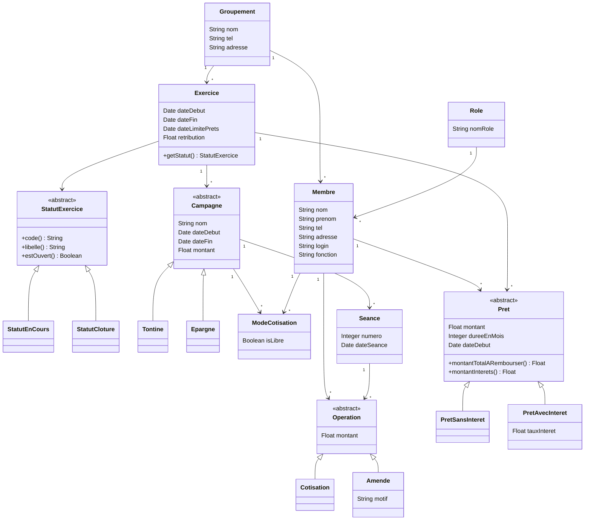

# Modélisation du projet gestion-prets

Ce document décrit le modèle de classes de l'application : groupements, exercices, membres, campagnes (tontines et épargnes), séances, opérations (cotisations et amendes) et prêts.

## Diagramme de classes

## Lecture du modèle

- Un **groupement** regroupe des membres et des exercices.
- Un **exercice** appartient à un groupement. Il a une période, une date limite pour les prêts, une rétribution (en pourcentage) et un statut (en cours ou clôturé). Il contient des campagnes et des prêts.
- **Campagne** est une classe abstraite : une campagne est toujours une `Tontine` ou une `Epargne`.
- **ModeCotisation** est une classe-association entre `Membre` et `Campagne` : `isLibre` indique si la cotisation est libre. Mermaid ne gère pas les classes-association, elle est donc dessinée avec deux relations.
- Une campagne se déroule en **séances** périodiques. À chaque séance, on enregistre des **opérations** pour chaque membre : `Cotisation` ou `Amende`.
- Un **membre** peut faire plusieurs **prêts**, chacun pour une durée donnée, dans un exercice. `Pret` est abstrait : `PretSansInteret` ou `PretAvecInteret`.
- Le **statut** d'un exercice est un objet : `StatutEnCours` ou `StatutCloture`, deux classes qui héritent de `StatutExercice`.

## Valeurs affichées dans les listes

- **Cumul d'un membre** : somme de ses cotisations sur les séances d'une campagne.
- **Montant total recouvré** : somme des cotisations d'une campagne.
- **Total des amendes** : somme des amendes d'une campagne.
- **Intérêts à verser à la caisse sociale** : somme des intérêts (`montantInterets()`) des prêts d'un exercice.

## Choix de conception

- **Héritage plutôt que tables de types ou énumérations** : ajouter un type de campagne, d'opération, de prêt ou de statut revient à créer une classe.
- **Polymorphisme** : `montantTotalARembourser()` est écrite différemment par chaque type de prêt, et `libelle()` par chaque statut.
- **Intérêts** : taux annuel en pourcentage, intérêts simples : montant × taux ÷ 100 × durée en mois ÷ 12.
- **Fabrique** : `StatutExercice::depuisCode()` transforme le code enregistré en base en objet de la bonne classe.